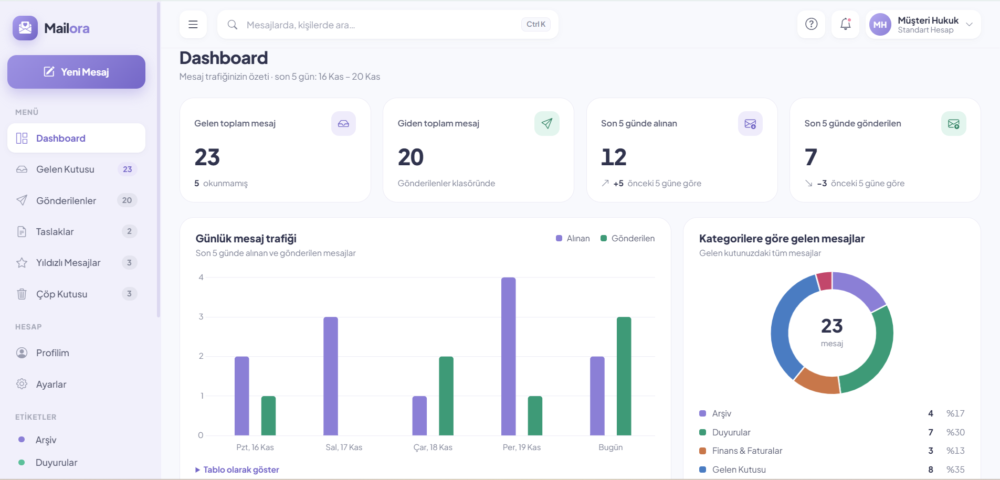
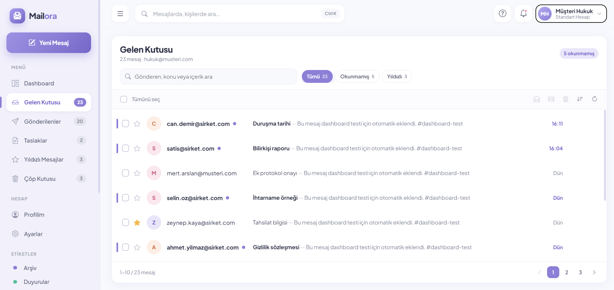
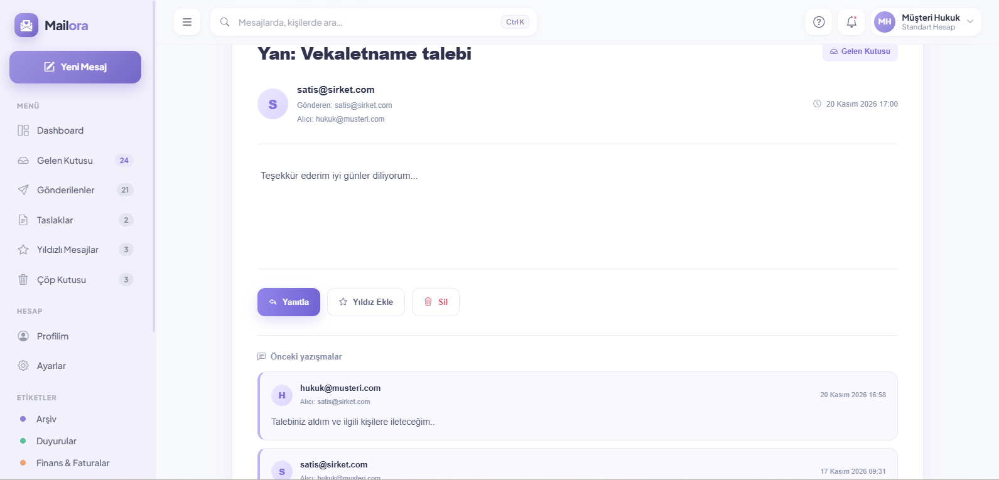
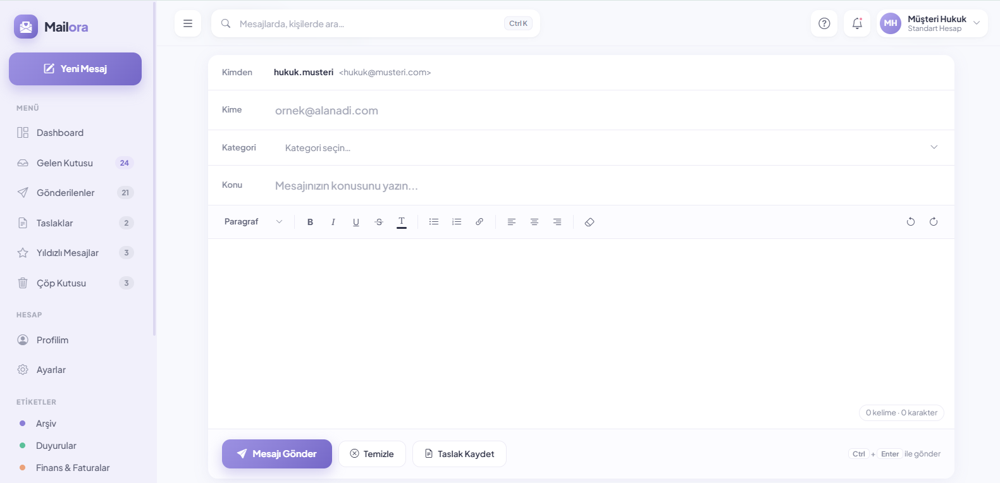
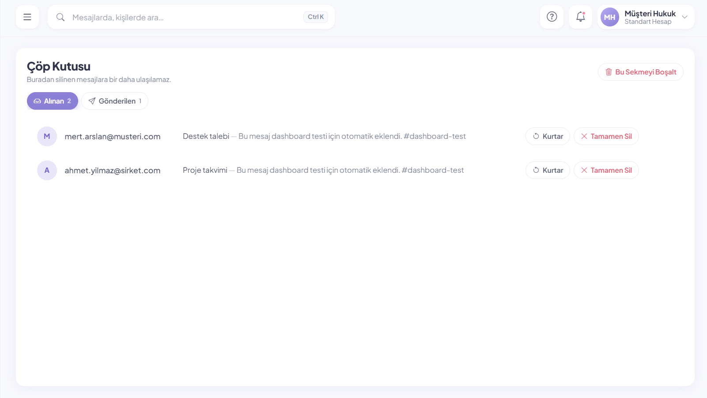
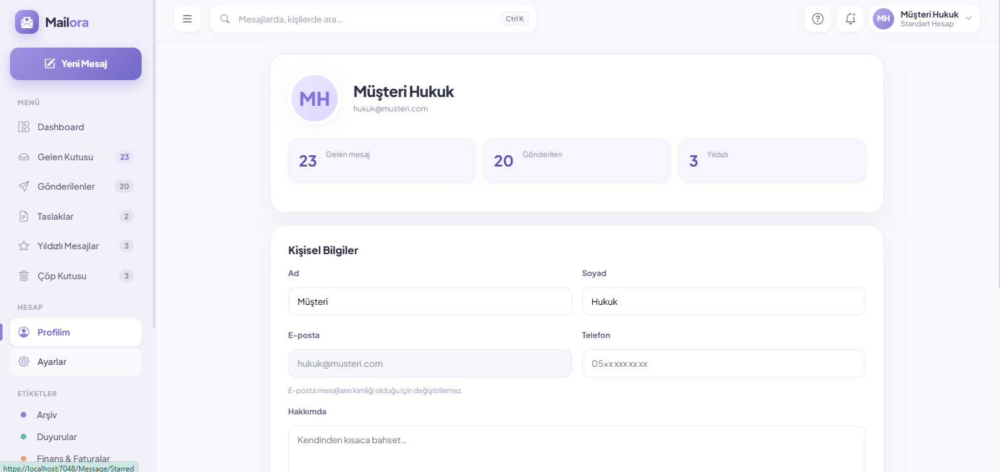
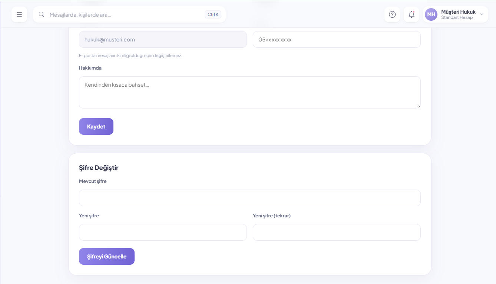
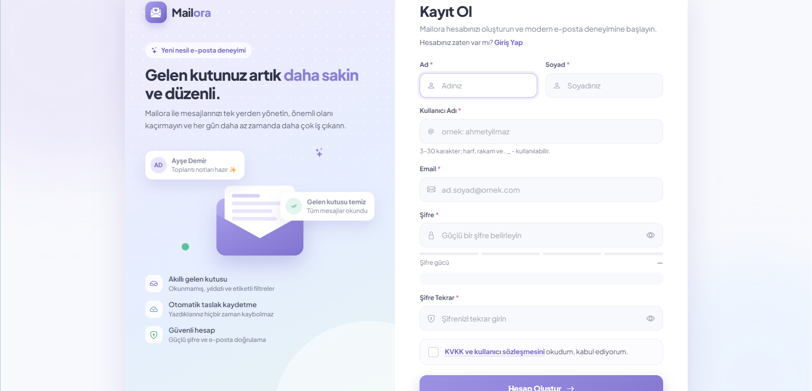
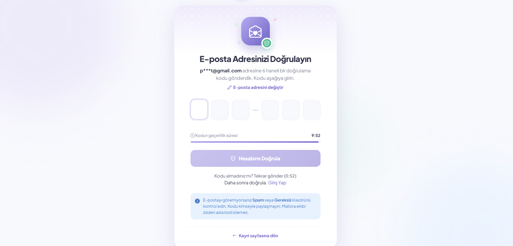
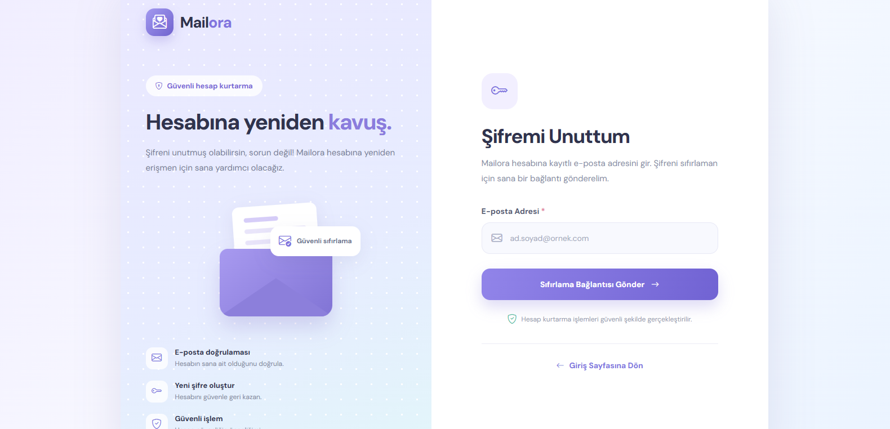

# 📬 Mailora — ASP.NET Core Identity ile E-posta Yönetim Paneli

**Mailora**, ASP.NET Core MVC (.NET 9) ve ASP.NET Core Identity ile geliştirilmiş, uygulama içi bir e-posta / mesajlaşma yönetim panelidir. Kullanıcılar kayıt olur, e-posta adreslerine gelen doğrulama koduyla hesaplarını aktifleştirir, giriş yapar ve birbirlerine mesaj gönderir. Gelen kutusu, gönderilenler, taslaklar, yıldızlı mesajlar, çöp kutusu, kategori etiketleri, arama ve istatistik sunan bir dashboard projenin başlıca parçalarıdır.

> Proje, **M&Y Yazılım Akademi** eğitim sürecinde Identity, Entity Framework Core ve SMTP ile e-posta gönderme konularını uygulamalı olarak öğrenmek için geliştirilmiştir.

---

## 📑 İçindekiler

- [Ekran Görüntüleri](#-ekran-görüntüleri)
- [Özellikler](#-özellikler)
- [Kullanılan Teknolojiler](#-kullanılan-teknolojiler)
- [Klasör Yapısı](#-klasör-yapısı)
- [Veri Modeli](#-veri-modeli)
- [Kurulum](#-kurulum)
- [Kullanım](#-kullanım)
- [Rotalar](#-rotalar)
- [Güvenlik Notları](#-güvenlik-notları)
- [Geliştirme Önerileri](#-geliştirme-önerileri)

---

## 🖼 Ekran Görüntüleri

### Dashboard
Son 5 günün gelen/giden mesaj trafiği, kategori dağılımı ve özet kartları.

[](docs/images/dashboard.png.png?raw=true)

### Gelen Kutusu

| Mesaj listesi | Mesaj detayı ve önceki yazışmalar |
|---|---|
| [](docs/images/inbox.png.png?raw=true) | [](docs/images/inbox2.png.png?raw=true) |

### Yeni Mesaj
Alıcı, kategori ve konu seçimi; zengin metin editörü, kelime sayacı ve taslak kaydetme.

[](docs/images/createMessage.png?raw=true)

### Çöp Kutusu

[](docs/images/trash.png.png?raw=true)

### Profil

| Profil bilgileri | Hakkımda ve şifre değiştirme |
|---|---|
| [](docs/images/profil1.png.png?raw=true) | [](docs/images/profile2.png.png?raw=true) |

### Kimlik Doğrulama Ekranları

| Kayıt Ol | E-posta Doğrulama | Şifremi Unuttum |
|---|---|---|
| [](docs/images/register.png.png?raw=true) | [](docs/images/emailVerificaiton.png.png?raw=true) | [](docs/images/forgottenPassword.png.png?raw=true) |

---

## ✨ Özellikler

### 🔐 Kimlik Doğrulama ve Hesap Yönetimi
- **Kayıt (Sign Up):** Ad, soyad, kullanıcı adı, e-posta ve şifre ile kayıt.
- **E-posta doğrulama:** Kayıt sonrası rastgele üretilen 6 haneli kod **MailKit** ile kullanıcının e-postasına gönderilir; kod girilince `EmailConfirmed = true` olur. Mail gönderilemezse kayıt geri alınır.
- **Giriş (Sign In):** Kullanıcı adı + şifre, "Beni hatırla" seçeneği ve güvenli `returnUrl` yönlendirmesi.
- **Hesap kilitleme:** 5 hatalı denemede hesap 5 dakika kilitlenir.
- **Güçlü şifre kuralları:** En az 8 karakter; büyük harf, küçük harf, rakam ve özel karakter zorunlu.
- **Şifremi unuttum:** Identity token'ı ile oluşturulan sıfırlama bağlantısı e-posta ile gönderilir.
- **Şifre değiştirme:** Profil sayfasından mevcut şifre ile yeni şifre belirleme.
- **Çerez ayarları:** 7 gün geçerli oturum çerezi, yetkisiz erişimde 403 sayfası.

### ✉️ Mesajlaşma
- **Yeni mesaj** oluşturma (alıcı, konu, içerik, kategori).
- **Yanıtlama** — `ParentMessageId` ile mesaj zinciri (thread) desteği.
- **Taslaklar** — mesajı göndermeden kaydetme, sonra düzenleyip gönderme veya silme.
- **Gelen Kutusu / Gönderilenler** — liste ve detay sayfaları.
- **Okundu / okunmadı** işaretleme.
- **Yıldızlı mesajlar** — favorilere ekleme/çıkarma.
- **Çöp kutusu** — gönderen ve alıcı için bağımsız soft delete; geri yükleme, kalıcı silme ve çöpü boşaltma.
- **Toplu silme** — birden çok mesajı seçip tek seferde silme.
- **Arama** — gönderen, konu ve içerikte arama.
- **Kategoriler (etiketler)** — mesajları kategoriye göre filtreleme.

### 📊 Dashboard
- Toplam gelen / giden ve okunmamış mesaj sayısı.
- Son 5 günde alınan ve gönderilen mesajlar ile önceki 5 güne göre değişim.
- **Chart.js** ile günlük mesaj trafiği (sütun grafik) ve kategori dağılımı (halka grafik).
- Gruplama veritabanında yapılır (`GROUP BY`), boş günler grafikte 0 olarak gösterilir.

### 👤 Profil
- Ad, soyad, telefon ve açıklama güncelleme.
- Gelen, gönderilen ve yıldızlı mesaj istatistikleri.

### 🧩 Arayüz
- Bootstrap 5, Bootstrap Icons ve Plus Jakarta Sans / DM Sans fontları ile modern tasarım.
- Tekrar eden parçalar **ViewComponent** olarak ayrıldı (sidebar, header, head, register stilleri vb.).
- Header'da dinamik kullanıcı adı ve bildirimler.
- Özel **401 / 403 / 404** hata sayfaları (`UseStatusCodePagesWithReExecute`).

---

## 🛠 Kullanılan Teknolojiler

| Katman | Teknoloji |
|---|---|
| Framework | ASP.NET Core MVC — **.NET 9** |
| Kimlik | ASP.NET Core Identity (`IdentityDbContext<AppUser>`) |
| ORM | Entity Framework Core 9 (Code First + Migrations) |
| Veritabanı | Microsoft SQL Server |
| E-posta | MailKit / MimeKit (Gmail SMTP) |
| Arayüz | Razor Views, Bootstrap 5.3, Bootstrap Icons, Chart.js 4 |
| İstemci | jQuery, jQuery Validation (Unobtrusive) |

---

## 📁 Klasör Yapısı

```
IdentityEmailProject/
├── MYAcademy_IdentityEmailProject.slnx        # Solution dosyası
├── docs/
│   └── images/                                # README ekran görüntüleri
└── MYAcademy_IdentityEmailProject/
    ├── Context/
    │   └── EmailContext.cs                    # IdentityDbContext + Messages, Categories
    ├── Controllers/
    │   ├── RegisterController.cs              # Kayıt + doğrulama kodu e-postası
    │   ├── ActivationController.cs            # E-posta doğrulama kodu kontrolü
    │   ├── LoginController.cs                 # Giriş / çıkış
    │   ├── PasswordChangeController.cs        # Şifremi unuttum / sıfırlama
    │   ├── ProfileController.cs               # Profil güncelleme, şifre değiştirme
    │   ├── MessageController.cs               # Tüm mesaj işlemleri
    │   ├── DashboardController.cs             # İstatistik ve grafik verileri
    │   ├── MessageLayoutController.cs
    │   ├── ErrorPagesController.cs            # 401 / 403 / 404
    │   └── HomeController.cs
    ├── Entities/
    │   ├── AppUser.cs                         # IdentityUser'dan türetilmiş kullanıcı
    │   ├── Message.cs
    │   └── Category.cs
    ├── Migrations/                            # EF Core migration dosyaları
    ├── Models/                                # ViewModel'ler
    │   ├── PasswordChangeModels/
    │   ├── ProfileViewModels/
    │   ├── DashboardViewModel.cs, CategorySlice.cs
    │   ├── UserRegisterViewModel.cs, UserLoginViewModel.cs, UserActivationViewModel.cs
    │   └── MessageLayoutHeaderViewModel.cs, HeaderNotificationItem.cs
    ├── ViewComponents/
    │   ├── MessageLayoutViewComponents/       # Head, Header, Sidebar
    │   └── RegisterViewComponents/            # Brand, Style, Script, Terms
    ├── Views/
    │   ├── Message/                           # Inbox, SendBox, Drafts, Starred, Trash, Search, Category, ...
    │   ├── Dashboard/, Profile/, Login/, Register/, Activation/, PasswordChange/
    │   ├── ErrorPages/                        # Page401, Page403, Page404
    │   ├── MessageLayout/                     # Panel ana layout'u
    │   └── Shared/                            # _Layout ve ViewComponent görünümleri
    ├── wwwroot/
    │   ├── css/, js/, lib/                    # Statik dosyalar ve kütüphaneler
    │   └── error-html/                        # Hata sayfası şablon dosyaları
    ├── Program.cs                             # Identity, cookie ve pipeline yapılandırması
    ├── appsettings.json
    └── MYAcademy_IdentityEmailProject.csproj
```

---

## 🗃 Veri Modeli

**AppUser** (`IdentityUser` + ek alanlar)

| Alan | Açıklama |
|---|---|
| `Name`, `Surname` | Ad, soyad |
| `Description` | Profil açıklaması |
| `ImageUrl` | Profil görseli |
| `ValidCode` | E-posta doğrulama kodu |

**Message**

| Alan | Açıklama |
|---|---|
| `Subject`, `MessageDetail` | Konu ve içerik |
| `SenderEmail`, `ReceiverEmail` | Gönderen / alıcı |
| `SendDate` | Gönderim tarihi |
| `IsRead`, `IsFavourite`, `IsDraft` | Okundu, yıldızlı, taslak bayrakları |
| `ParentMessageId` | Yanıtlanan mesaj (thread) |
| `DeletedBySender`, `DeletedByReceiver` | Çöp kutusuna taşındı (soft delete) |
| `PurgedBySender`, `PurgedByReceiver` | Çöp kutusundan kalıcı silindi |
| `CategoryId` → **Category** | Mesaj kategorisi |

**Category**: `CategoryId`, `CategoryName`, `Messages` (1‑N)

---

## 🚀 Kurulum

### Gereksinimler
- [.NET 9 SDK](https://dotnet.microsoft.com/download/dotnet/9.0)
- Microsoft SQL Server (LocalDB, Express veya Developer)
- Visual Studio 2022 (17.12+) / VS Code / Rider
- SMTP için bir Gmail hesabı ve **Uygulama Şifresi** (App Password)

### 1. Depoyu klonlayın

```bash
git clone https://github.com/HalilGorkemUysal/IdentityEmailProject.git
```

```bash
cd IdentityEmailProject/MYAcademy_IdentityEmailProject
```

### 2. Bağlantı dizesini düzenleyin

`Context/EmailContext.cs` içindeki sunucu adını kendi SQL Server örneğinizle değiştirin:

```csharp
optionsBuilder.UseSqlServer("Server=SUNUCU_ADINIZ;Database=IdentityEmailDb;Integrated Security=True;TrustServerCertificate=True;");
```

LocalDB kullanıyorsanız: `Server=(localdb)\\MSSQLLocalDB;...`

### 3. SMTP ayarlarını yapın

`Controllers/RegisterController.cs` ve `Controllers/PasswordChangeController.cs` içindeki gönderici adresini ve `smtpClient.Authenticate(...)` bilgilerini kendi Gmail adresiniz ve uygulama şifrenizle güncelleyin. (Bkz. [Güvenlik Notları](#-güvenlik-notları))

### 4. Veritabanını oluşturun

```bash
dotnet tool install --global dotnet-ef
```

```bash
dotnet ef database update
```

Visual Studio'da **Package Manager Console** üzerinden `Update-Database` komutunu da kullanabilirsiniz.

### 5. Kategorileri ekleyin

Mesaj oluştururken kategori seçimi zorunludur; migration'da başlangıç verisi bulunmadığından birkaç kategori ekleyin:

```sql
INSERT INTO Categories (CategoryName) VALUES (N'Arşiv'), (N'Duyurular'), (N'Finans & Faturalar'), (N'İş'), (N'Kişisel');
```

### 6. Uygulamayı çalıştırın

```bash
dotnet run --launch-profile https
```

Uygulama varsayılan olarak şu adreslerde açılır:
- https://localhost:7048
- http://localhost:5047

---

## 📖 Kullanım

1. **Kayıt olun:** `/Register/SignUp` sayfasından hesap oluşturun.
2. **E-postanızı doğrulayın:** Gelen 6 haneli kodu `/Activation/UserActivation` ekranına girin.
3. **Giriş yapın:** `/Login/SignIn` üzerinden kullanıcı adı ve şifrenizle giriş yapın; gelen kutusuna yönlendirilirsiniz.
4. **Mesaj gönderin:** "Yeni Mesaj" ile alıcının e-posta adresini, konuyu, kategoriyi ve içeriği girin. İsterseniz taslak olarak kaydedin.
5. **Mesajları yönetin:** Yıldızlayın, okunmadı olarak işaretleyin, yanıtlayın, çöp kutusuna taşıyın, geri yükleyin veya kalıcı silin.
6. **Dashboard'u inceleyin:** Mesaj trafiğinizi ve kategori dağılımını grafiklerle görün.
7. **Profilinizi güncelleyin:** Kişisel bilgilerinizi düzenleyin veya şifrenizi değiştirin.
8. **Şifrenizi mi unuttunuz?** `/PasswordChange/ForgetPassword` sayfasından sıfırlama bağlantısı isteyin.

> 💡 Test için iki farklı hesap açıp birbirinize mesaj göndermeniz önerilir.

---

## 🧭 Rotalar

| Rota | Açıklama |
|---|---|
| `/Register/SignUp` | Kayıt |
| `/Activation/UserActivation` | E-posta doğrulama |
| `/Login/SignIn` | Giriş |
| `/PasswordChange/ForgetPassword` | Şifremi unuttum |
| `/PasswordChange/ResetPassword` | Şifre sıfırlama |
| `/Dashboard/Index` | Dashboard |
| `/Message/Inbox` | Gelen kutusu |
| `/Message/Inbox/{id}` | Gelen mesaj detayı |
| `/Message/SendBox` | Gönderilenler |
| `/Message/Sent/{id}` | Gönderilen mesaj detayı |
| `/Message/CreateMessage` | Yeni mesaj / yanıt / taslak düzenleme |
| `/Message/Drafts` | Taslaklar |
| `/Message/Starred` | Yıldızlı mesajlar |
| `/Message/Trash` | Çöp kutusu |
| `/Message/Search?q=` | Arama |
| `/Profile/Index` | Profil |
| `/ErrorPages/Page401`, `Page403`, `Page404` | Hata sayfaları |

`Message` ve `Profile` controller'ları `[Authorize]` ile korunur; POST işlemleri `[ValidateAntiForgeryToken]` kullanır.

---

## 🔒 Güvenlik Notları

- SMTP kullanıcı adı ve uygulama şifresi şu anda controller'larda **sabit olarak** yazılıdır. Gerçek bir ortamda bu bilgileri koddan çıkarıp **User Secrets**, ortam değişkenleri veya `appsettings` + `IOptions` yapısı ile yönetin:

  ```bash
  dotnet user-secrets set "Smtp:Password" "uygulama-sifreniz"
  ```

- Depoda daha önce paylaşılmış uygulama şifreleri varsa Google hesabınızdan **iptal edip yenisini oluşturun**.
- Bağlantı dizesini de `appsettings.json` → `ConnectionStrings` altına taşımanız önerilir.
- `Program.cs` içindeki `opt.SignIn.RequireConfirmedEmail = true` satırı açılarak e-postası doğrulanmamış kullanıcıların girişi engellenebilir.

---

## 🧱 Geliştirme Önerileri

- [ ] SMTP ayarlarını `IEmailSender` servisine ve yapılandırma dosyasına taşımak
- [ ] Kategoriler için `HasData` ile seed verisi eklemek
- [ ] Profil fotoğrafı yükleme (`IFormFile`)
- [ ] Mesajlara dosya eki desteği
- [ ] Repository / Service katmanı ile iş mantığını controller'lardan ayırmak
- [ ] Birim ve entegrasyon testleri

---

## 👤 Geliştirici

**Halil Görkem Uysal** — [GitHub](https://github.com/HalilGorkemUysal)
